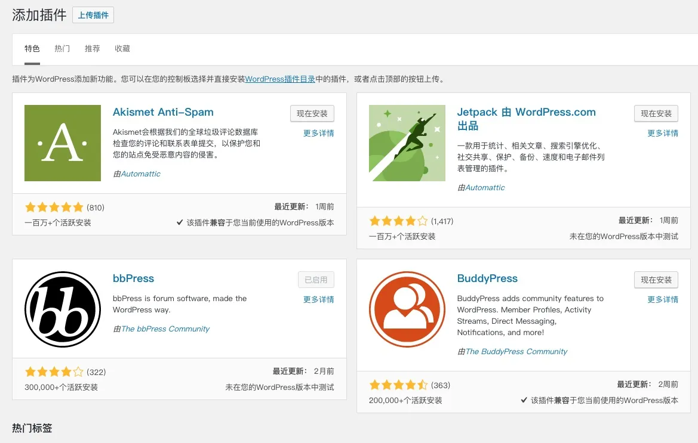
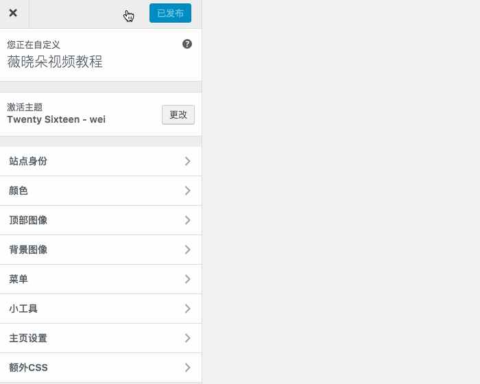
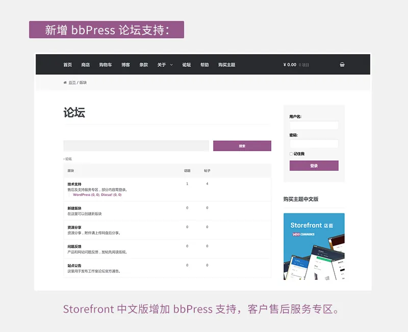
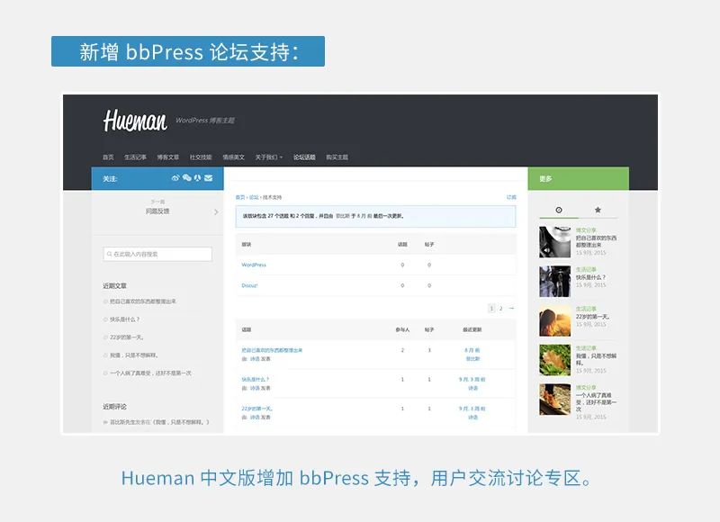

bbPress 是一款简单易用的 WordPress 论坛程序，默认界面并不是很友好，需要主题兼容不然会非常简陋，这是薇晓朵制作分享的一款 bbPress 中文主题以替代其默认界面。
如何使用和添加代码：
1、首先请确保你已经安装了 bbPress 论坛，可在 WordPress 网站后台直接搜索：bbPress 进行安装。


---

2、请打开网站前台编辑器的【自定义】，复制下方美化代码到自定义 css 中。


---

3、美化代码内容如下：

```
/* bbPress China theme by Weixiaoduo.com
* Theme URL: https://www.weixiaoduo.com/themes/bbpress-china-theme
* 如下修改 CSS 和界面样式请在下方调整，bbPress 中文通用美化代码由薇晓朵提供，如需帮助请到支持论坛。
* */

html {
-webkit-font-smoothing: antialiased;
}

body {
font: 14px/25px PingFang SC, Microsoft YaHei, WenQuanYi Micro Hei, Arial, Helvetica, sans-serif;
}

#bbpress-forums li.bbp-header { border-top: none }
#bbpress-forums li.bbp-header,
#bbpress-forums li.bbp-footer { background: #f7f7f7 }
.content-area .forum-titles { font-weight: bold; font-weight: 600; color: #777; }
.content-area .bbp-forum-title,
.content-area .bbp-topic-permalink { color: #222; font-weight: bold; font-weight: 600; font-size: 13px; margin: 0; }
#bbpress-forums .bbp-forum-info .bbp-forum-content,
#bbpress-forums p.bbp-topic-meta { font-size: 13px }
#bbpress-forums li.bbp-header,
#bbpress-forums li.bbp-footer,
#bbpress-forums li.bbp-body ul.forum,
#bbpress-forums li.bbp-body ul.topic,
div.bbp-forum-header,
div.bbp-topic-header,
div.bbp-reply-header,
li.bbp-body div.hentry { padding: 15px 15px }
#bbpress-forums div.odd,
#bbpress-forums ul.odd { background: none }
#bbpress-forums .bbp-forum-info .bbp-forum-content,
#bbpress-forums p.bbp-topic-meta { margin-bottom: 0; margin-top: 0; }
.bbp-reply-author { text-align: left !important }
#bbpress-forums fieldset.bbp-form label { margin-bottom: 5px }
.bbp-topics-front ul.super-sticky,
.bbp-topics ul.super-sticky,
.bbp-topics ul.sticky,
.bbp-forum-content ul.sticky { background: none !important; font-size: 1em; }
#bbpress-forums fieldset.bbp-form p,
#bbpress-forums fieldset.bbp-form textarea,
#bbpress-forums fieldset.bbp-form select { margin-bottom: 20px }
div.bbp-submit-wrapper { float: none; margin-top: 0; }
div.bbp-submit-wrapper button { width: 100%; }
#bbpress-forums div.bbp-the-content-wrapper div.quicktags-toolbar { border: 1px solid #eee; border-radius: 0; }
#bbpress-forums div.bbp-the-content-wrapper textarea.bbp-the-content { background: none; border: 1px solid #eee; border-top: none; color: #555; }
div.bbp-forum-header,
div.bbp-topic-header,
div.bbp-reply-header { border-color: #eee }
#bbpress-forums div.bbp-forum-header,
#bbpress-forums div.bbp-topic-header,
#bbpress-forums div.bbp-reply-header { background: #f5f5f5 }
#bbpress-forums li.bbp-header,
#bbpress-forums li.bbp-footer { font-weight: bold; font-weight: 600; color: #777; }
#bbpress-forums li.bbp-footer { display: none }
#bbpress-forums .status-trash.odd { background: none }
#bbpress-forums .status-spam,
#bbpress-forums .status-spam.odd { opacity: 0.3; background: #f7f7f7; }
span.bbp-admin-links a { color: #666 }
#bbpress-forums div.bbp-reply-content { padding: 15px }
#bbpress-forums div.reply { box-sizing: border-box; -moz-box-sizing: border-box; -webkit-box-sizing: border-box; }
#bbpress-forums .bbp-search-author,
#bbpress-forums .bbp-search-content { text-align: left }
.bbp-search .bbp-meta { display: none }
#bbpress-forums div.bbp-forum-title h3,
#bbpress-forums div.bbp-topic-title h3,
#bbpress-forums div.bbp-reply-title h3 { font-size: 14px; font-weight: bold; font-weight: 600; }
.bbpress #subscription-toggle {float: right;}
/* hide pagination count */
.bbp-pagination-count { display: none }
/* search + breadcrumbs */
#bbp_search,
#bbp_search_submit { height: 30px; margin-bottom: 20px; padding-top: 0; padding-bottom: 0; }
#bbpress-forums div.bbp-search-form { float: none }
#bbp_search { width: 70% !important; float: left; height: 40px; }
#bbp_search_submit { float: right; width: 28%; height: 40px; line-height: 40px; padding-top: 0; padding-bottom: 0; }
/* hide "freshness */
.forum-archive .bbp-topic-freshness,
.forum-archive .bbp-forum-freshness,
li.bbp-forum-freshness { display: none }
li.bbp-forum-info,
li.bbp-topic-title { width: 55% }
/* hide social */
body.bbpress .social-share-title,
body.bbpress .social-share-buttons { display: none }
/* login */
.bbp-login-form,
.bbp-logged-in { background: #f7f7f7; border: 1px solid #eee; padding: 20px; }
.bbp-login-form label { width: auto; margin-bottom: 5px; color: #000; }
.bbp-login-form input[type="text"],
.bbp-login-form input[type="password"] { background: #fff; width: 100%; max-width: 100%; border: 1px solid #eee; }
.bbp-login-form input[type="text"]:focus,
.bbp-login-form input[type="password"]:focus { border-color: #bbb; box-shadow: 0 1px 2px rgba(0,0,0,0.1); }
#sidebar .bbp-login-form label[for=rememberme] { width: auto }
/* logged in */
.bbp-logged-in h4 { margin: 0 0 10px; font-weight: bold; font-weight: 600; font-size: 14px; }
.bbp-logged-in .user-submit { float: right }
.bbp-logged-in .user-submit img { display: block; background: #fff; padding: 3px; border: 1px solid #e4e4e4; }
.bbp-logged-in .user-submit img:hover { opacity: 0.8; -moz-opacity: 0.8; -webkit-opacity: 0.8; }
.bbp-logged-in img.avatar { margin: 0 }
.bbp-login-form:after,
.bbp-logged-in:after { content: ""; display: block; clear: both; }
/* bbpress stats */
.widget_display_stats dt { float: left; width: 80%; background: #f7f7f7; padding: 0 12px; text-align: left; height: 40px; line-height: 40px; margin-bottom: 10px; box-sizing: border-box; -moz-box-sizing: border-box; -webkit-box-sizing: border-box; border: 1px solid #eee; border-right: none; }
.widget_display_stats dd { float: left; width: 20%; background: #f3f3f3; border: 1px solid #eee; color: #000; text-align: center; padding: 0 12px; height: 40px; line-height: 40px; margin-bottom: 10px; box-sizing: border-box; -moz-box-sizing: border-box; -webkit-box-sizing: border-box; }
/* bbpress notice */
div.bbp-template-notice, div.indicator-hint {
border-width: 2px;
border-style: solid;
padding: 0 0.6em;
margin: 5px 0 15px;
border-radius: 0px;
background-color: #ffffe0;
border-color: #e6db55;
color: #000;
clear: both;
}
div.bbp-template-notice p {
margin: 0.5em 0 10px 0 !important;
padding: 5px;
font-size: 13px;
line-height: 150%;
}
div.bbp-template-notice p {
margin: 0.5em 0 10px 0 !important;
padding: 10px;
font-size: 13px;
line-height: 150%;
}
div.bbp-template-notice.info {
border: #cee1ef 2px solid;
background-color: #f0f8ff;
}
div.bbp-template-notice.important {
border: #e6db55 2px solid;
background-color: #fffbcc;
}
#bbpress-forums p.bbp-topic-meta img.avatar, #bbpress-forums ul.bbp-reply-revision-log img.avatar, #bbpress-forums ul.bbp-topic-revision-log img.avatar, #bbpress-forums div.bbp-template-notice img.avatar, #bbpress-forums .widget_display_topics img.avatar, #bbpress-forums .widget_display_replies img.avatar {
float: none;
margin-bottom: -7px;
border: 3px double #ddd;
display: none !important;
}
div.bbp-submit-wrapper button {
width: 100%;
font-size: 14px;
color: #FFFFFF;
font-weight: 700;
}
#bbpress-forums div.bbp-forum-author img.avatar, #bbpress-forums div.bbp-topic-author img.avatar, #bbpress-forums div.bbp-reply-author img.avatar {
border: none;
max-width: 80px;
padding: 0;
margin: 12px auto 0 auto;
float: none;
padding: 5px;
/* height: 80px; */
/* width: 80px; */
border: 1px solid #e7e7e7;
/* -webkit-box-shadow: 0 0 7px rgba(0,0,0,.1); */
-moz-box-shadow: 0 0 7px rgba(0,0,0,.1);
/* box-shadow: 0 0 7px rgba(0,0,0,.1); */
background: #fff;
}
```

---

4、调整为适合你主题的颜色及样式，
这就看具体情况了，因为是通用代码，我们尽量没有加入太多个性化的东西，如果你想要改颜色和样式的话就需要改上面的 css 来和你自己的主题匹配，

---

比如我们做的几款中文主题集成的样式：


