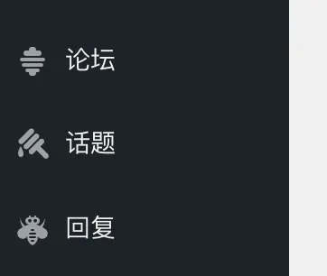
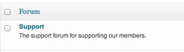
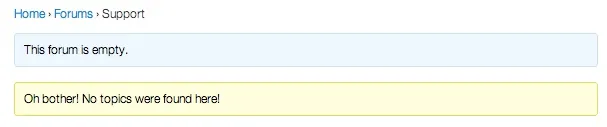
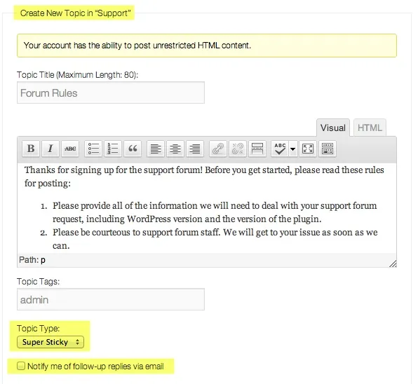
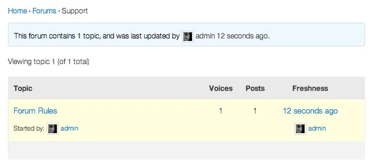
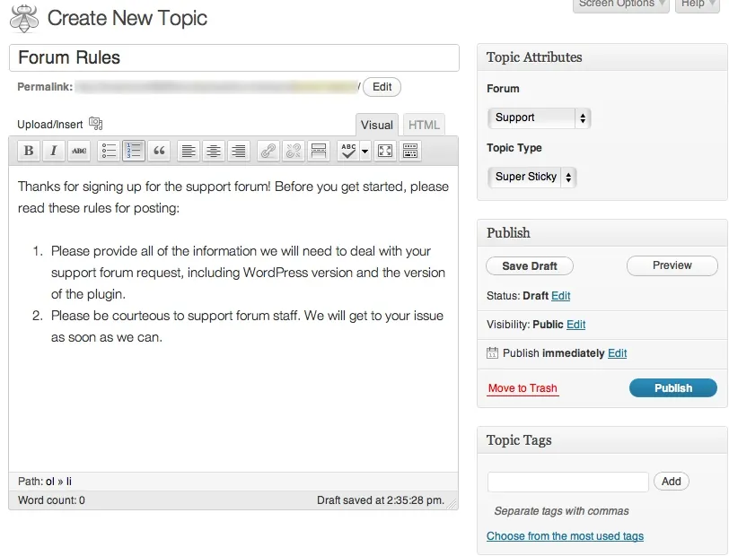
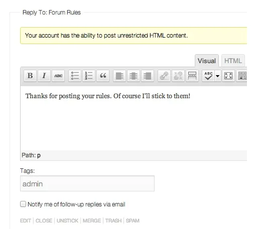
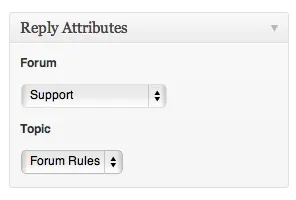

bbPress 在 WordPress 后端创建了三个新菜单项来管理您的三种[自定义文章类型](https://codex.wordpress.org/Post_Types#Custom_Post_Types)。它们是：

- 论坛- 包含在论坛中创建的所有话题和回复。
- 话题- 话题是在论坛中创建的，它们是正在讨论的话题。
- 回复- 回复是实际发生的讨论。它们是在话题内创建的，如果启用了线程回复，则可以回复其他用户的回复。

本指南将帮助您创建每个文章类型、为您的论坛构建类别，并解释任何其他属性以自定义每个文章类型。

### [创建论坛](#creating-a-forum)

要创建论坛，请按照下列步骤操作：

1. 导航到论坛 > 新论坛。
2. 为您的论坛命名。
3. 可选：您可以在描述区域添加文本来描述您的特定论坛。
4. 调整任何其他论坛属性。

类型：选择是创建论坛还是类别。
论坛– 可以包含话题并成为其他论坛的父论坛。
类别– 只能包含论坛（无话题）。用于组织您的论坛。
例如，您可能有一个“开源软件”类别，其中包含论坛“bbPress”和“WordPress”。
状态：选择论坛是打开还是关闭。
开放- 论坛用户可以在论坛中创建新话题。
关闭- 关闭论坛不允许创建任何新话题，也不允许对论坛中任何现有话题的任何新回复。如果是分类或其他论坛的父论坛，关闭该分类或父论坛将关闭其所有子论坛。
可见性：决定您的论坛是公开的、私密的还是隐藏的。
公开– 任何人都可以看到这些论坛
私人- 只有登录的注册用户才能看到这些论坛
隐藏- 只有版主/管理员可以看到这些论坛
父：论坛可以具有层次结构。如果您的论坛是另一个论坛的子论坛或某个类别的子论坛，请在此处添加父论坛。
顺序：这决定了论坛出现的顺序。用序号调整每个论坛以重新排列您的论坛。
当您满意时，点击发布。
默认情况下，您的论坛将位于http://yourdomain.com/forums/forum/yourforumname
要调整默认 slug，请访问论坛 > 设置

### [创建话题](#creating-a-topic)

创建论坛后，您可以开始添加话题。您可以从前端或 WordPress 后端添加话题。

### [从前端添加话题](#adding-a-topic-from-the-front-end)

在前端导航到您的论坛。如果您刚刚设置了您的论坛，它将没有话题。

为您的话题命名并为其添加一些内容。

您可以添加用于组织话题的标签，并且可以使帖子具有粘性或超级粘性。
粘性- 帖子将粘在其所在论坛的顶部。
超级粘性- 帖子将粘在所有论坛的顶部。
您还可以选择通过电子邮件订阅回复。
发布话题后，它将出现在您的论坛上。

### [从 WordPress 后端添加话题](#adding-a-topic-from-the-wordpress-backend)

要从 WordPress 后端添加话题，

1. 导航到话题 > 新话题。
2. 给您的话题一个标题和一些内容。
3. 调整任何其他话题属性。

类型： 指示话题类型为粘性或正常。
正常- 这将是话题的默认类型，这不会将话题粘贴到任何地方。
粘性– 将话题粘贴到他们所在的单个论坛的顶部。
超级粘性– 将话题粘贴到您网站上所有论坛的顶部。
状态： 表示话题状态。
开放- 没有任何限制的正常话题。您网站上的所有论坛用户都可以回复此话题。
已关闭– 参与者无法进行任何进一步回复。不过，版主和键盘管理员仍然可以回复这些封闭的话题。
垃圾邮件– 将话题标记为垃圾邮件。该话题现在将显示在您的垃圾邮件队列中。
捣毁-在垃圾桶里，从中可以永久删除它就把话题。
待定- 等待批准发布的话题。
论坛： 选择您要添加话题的论坛。
您还可以看到输入话题标签、密码保护话题、将话题设置为仅供管理员/密钥管理员专用的区域。
完成创建话题后，单击发布。

### [创建回复](#creating-a-reply)

与话题一样，可以从您网站的前端或 WordPress 后端添加回复。
从前端添加回复
要从前端回复，请导航到您的论坛并单击您要回复的话题。
添加您的回复。您还可以选择通过电子邮件接收后续回复的通知。

添加回复后，您会在回复 > 所有回复中看到它已添加到 WordPress 后端
添加来自 WordPress 后端的回复
要添加来自 WordPress 后端的回复，

1. 导航到回复 > 新回复。
2. 给您的话题一个标题和一些内容。
3. 调整任何其他回复属性。

论坛：选择要回复的论坛。
话题：输入您希望回复的话题的 ID。
回复：如果您启用了线程回复，这很有用。您输入要在其下发送的回复的 ID。
您的回复现在将显示在您网站的前端。
您现在已经拥有开始使用 bbPress 创建论坛所需的一切！
