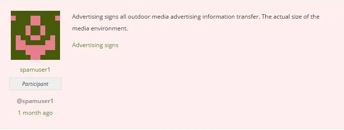
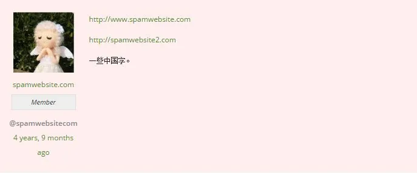
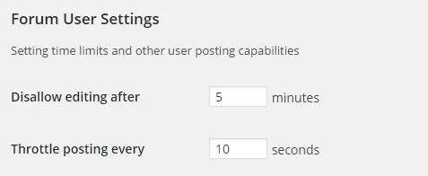
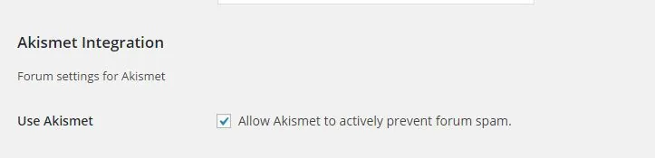
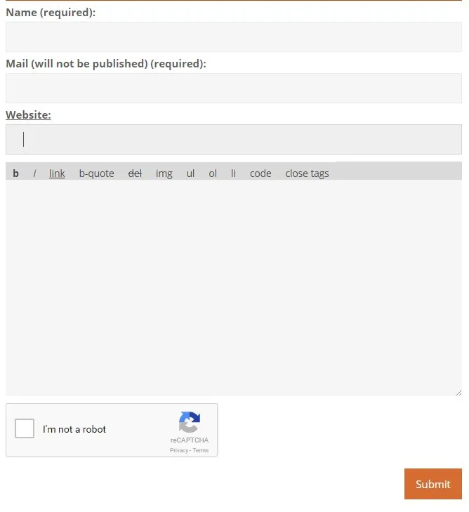
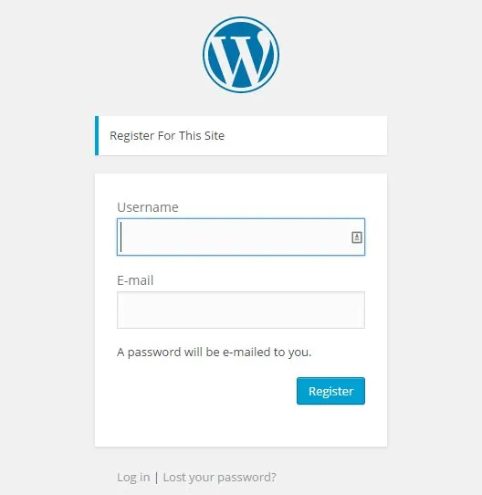

您的站点上有许多垃圾邮件可能会造成严重破坏的区域，您需要关注这些区域，虽然垃圾邮件会增加论坛版主和键盘管理员的工作量，但他的指南有望引导您朝着正确的方向添加一道防御墙反对垃圾邮件并帮助将您网站上的垃圾邮件降至最低。

### [识别垃圾邮件](#identifying-spam)

> 什么是垃圾邮件？

垃圾邮件最常见的是由链接组成，更常见的是包含通向外部网站的广告，目的是提高搜索引擎的可见性并为其网站产生更多流量。
通常有两种类型的垃圾邮件发送者。

- 自动化- 主要是能够在网站上注册帐户并发布的脚本。
- 人类 - 一个真正的人类垃圾邮件网站。

自动垃圾邮件机器人
下面是一个垃圾邮件机器人的例子，它会留下与此类似的帖子。

自动垃圾邮件机器人很可能会执行下面列出的所有操作。

- 放置一个或多个链接到一个或多个站点的业务或服务。Ť他链接可能大量文本来隐藏它不容易被看到。
- 在帖子中留下他们网站的描述以及他们的论坛资料。
- 颠簸并回复旧话题。
- 回复话题并留下最少的回复，例如“好”，或复制话题中的现有回复但在最后插入链接。
- 某些话题的标题似乎与帖子内容中的信息无关。
- 发表题外话的回复。
- 将他们的显示名称和用户名作为他们链接到的网站。
- 用一种完全不同的语言发帖，然后是话题中的内容。

这些通常会自动填写大多数输入字段，并且很容易发现和识别。本指南中列出的一些插件可以轻松处理这些垃圾邮件发送者。
人类垃圾邮件发送者
下面是一个人类垃圾邮件发送者的示例，他发布了与此类似的帖子。有些不会像这那么明显，所以主持人决定再做进一步的决定。

人类垃圾邮件发送者很可能会做下面列出的所有事情，也可能会做一些普通垃圾邮件机器人会做的事情。

- 通过大多数垃圾邮件检查。
- 可以有一个 Gravatar。
- 发表话题回复。
- 碰撞和回复随机话题。
- 不经常发帖。

将垃圾邮件发送者与论坛中的其他用户区分开来可能非常困难，但您可以通过查看他们在论坛个人资料中的活动，通过他们在您网站上的行为来识别垃圾邮件发送者。
最好让论坛中的版主根据他们对用户的观察来确定哪些用户实际上是垃圾邮件发送者，并查看他们是否执行了上述任何操作。

### [处理垃圾邮件的内置工具](#inbuilt-tools-to-handle-spam)

所有这些设置都应该在 WordPress 后端的Settings > Forums 中。
编辑时间
bbPress 允许用户编辑自己的话题和回复。这对于修复轻微的错别字非常有用，不幸的是，它也让一些垃圾邮件发送者有机会先写一个友好的回复，然后再编辑它以链接回垃圾邮件发送者的网站。
5 分钟的默认设置应该没问题。降低此设置会更好，但请确保这不会惹恼您的用户。此设置不会影响 Keymasters 和版主，因为他们可以无限期地编辑帖子。
节流时间
节流时间或洪水控制是单个作者能够发布所需的时间量。这是为了避免用户在短时间内多次发帖，并有助于避免垃圾邮件程序的滥用。
默认设置为 10 秒就可以了。将此设置调高会更好，但请确保它不会惹恼您的用户。
Akismet 集成

bbPress 与 Akismet 完全集成。Akismet 在发布之前扫描 bbPress 话题或回复，以查看它是垃圾邮件还是非垃圾邮件（不是垃圾邮件），它的扫描服务运行数百次测试，并将帖子标记为垃圾邮件。如果它确实捕获了垃圾邮件话题，您将在 WordPress 后端垃圾邮件下的话题部分看到它，以及相同的回复过程。
使用 WordPress 评论审核设置
没有多少人知道这一点，但您可以使用 WordPress 的 bbPress 评论审核和黑名单设置。您可以在[审核和黑名单](/moderation-and-blacklisting/) 指南中找到更多相关信息。
如果您需要将精选的单词列表添加到评论黑名单中，您可以[在 Github 上](https://github.com/splorp/wordpress-comment-blacklist/)找到一个[列表，](https://github.com/splorp/wordpress-comment-blacklist/) 然后您可以从那里复制您需要的任何文件中的文本。在页面上，您可以在下面阅读[如何](https://github.com/splorp/wordpress-comment-blacklist/#how-do-i-use-it)手动[使用它](https://github.com/splorp/wordpress-comment-blacklist/#how-do-i-use-it)或安装诸如评论黑名单管理器之类的插件，该插件会自动将策划列表更新到您的评论黑名单部分。

### [话题和回复表单保护](#topic-and-reply-form-protection)

阻止垃圾帖子出现在您的论坛上的一种好方法是对该话题进行某种保护，并在您的论坛中回复创建表单。有很多像 Akismet 这样的插件与 bbPress 集成，以帮助阻止垃圾邮件发送者发布任何乱七八糟的东西。如果您在您的网站上启用了匿名发布，那么在话题和回复表单上针对垃圾邮件发送者提供某种保护特别有用。启用此功能将允许任何人在您的 bbPress 论坛上发帖，甚至无需在您的网站上注册，启用匿名发帖会让垃圾邮件因此而肆虐。如果您确实想使用匿名发帖，建议您保护话题和回复表单免受垃圾邮件的影响。
查看 WordPress.org 主页下面列出的任何插件，了解有关设置的更多信息。
使用验证码

- [高级 noCaptcha reCaptcha](https://wordpress.org/plugins/advanced-nocaptcha-recaptcha/) – 使用 Google 的 reCAPTCHA 服务在话题和回复表单上显示验证码。
- [数学验证码](https://wordpress.org/plugins/wp-math-captcha/)——这只是一个简单的数学验证码。

使用蜜罐

- [Spam Destroyer](https://wordpress.org/plugins/spam-destroyer/)  – 在话题和回复表单上插入一个隐藏字段，在大多数情况下，垃圾邮件机器人会自动填写这些表单，并被视为垃圾邮件发送者。

审核通知
使用[bbPress Notify，](https://wordpress.org/plugins/bbpress-notify/) 您可以选择接收任何新话题/回复帖子通知的角色。
手动批准
安装[bbPress 审核](https://wordpress.org/plugins/bbpressmoderation/)将使您能够手动批准待审核的话题和回复等待审核。

### [注册垃圾邮件](#registration-spam)

确保您的站点注册表上有某种垃圾邮件保护措施，因为这是 bbPress 站点的访问点。让它成为注册蜜罐、验证码、问题和 IP 黑名单数据库，以阻止垃圾邮件发送者访问您的站点。
如果您安装了 BuddyPress，还可以查看[他们的指南，](https://codex.buddypress.org/getting-started/guides/preventing-spammer-registration/)了解一些与 BuddyPress 的注册过程和表单一起使用的插件。
查看 WordPress.org 主页下面列出的任何插件，了解有关设置的更多信息。
需要电子邮件确认
避免垃圾邮件注册人的一种方法是要求新注册人确认他们的电子邮件以进行启用。WordPress 存储库中有大量插件允许这种功能，有些还允许自定义登录/注册表单，例如 [Theme My Login](https://wordpress.org/plugins/theme-my-login/)。
手动批准新注册人
手动批准用户可能对小型利基社区或遭受大型垃圾邮件攻击且现在希望允许管理员手动批准每个新用户的站点有用。幸运的是，有几个 WordPress 插件可以做到这一点，这是为数不多的[WP Approve User 之一](https://wordpress.org/plugins/wp-approve-user/)。
仅限邀请
对于非常私密的站点，您可以允许使用[WP-Invites](https://wordpress.org/plugins/wp-invites/)向某些成员发送邀请 。
注册验证码

- [WangGuard](https://wordpress.org/plugins/wangguard/) – 允许用户在注册期间输入自定义问题的答案。您可以在插件设置中输入多个自定义问题供注册人尝试回答。
- [高级 noCaptcha reCaptcha](https://wordpress.org/plugins/advanced-nocaptcha-recaptcha/)  – 使用 Google 的 reCAPTCHA 服务在注册表单上显示验证码。
- [数学验证码](https://wordpress.org/plugins/wp-math-captcha/) ——这只是一个简单的数学验证码。

注册蜜罐

- [Spam Destroyer](https://wordpress.org/plugins/spam-destroyer/)  – 在 bbPress 注册页面上插入一个隐藏字段，默认的 WordPress 注册页面，多站点兼容。
- [WangGuard](https://wordpress.org/plugins/wangguard/) - 包括在注册表中插入蜜罐的选项。

IP 黑名单数据库
要使用 IP 黑名单数据库根据他们的 IP 检查尝试注册的当前用户是否是垃圾邮件发送者，您可以使用下面列出的任何插件。

|  |  |
| --- | --- |
| 插件名称 | 黑名单数据库 |
| [阻止垃圾邮件发送者 垃圾邮件预防](https://wordpress.org/support/view/plugin-reviews/stop-spammer-registrations-plugin) | StopForumSpam、Project Honeypot、BotScout、Spamhaus |
| [不良行为](https://wordpress.org/plugins/bad-behavior/) | 蜜罐计划 |
| [AP 蜜罐 WordPress 插件](https://wordpress.org/plugins/ap-honeypot/) | 蜜罐计划 |
| [WP 停止论坛垃圾邮件](https://wordpress.org/plugins/wp-stop-forum-spam/) | 停止论坛垃圾邮件 |

IP 黑名单数据库站点\*
[停止论坛垃圾邮件](http://www.stopforumspam.com/)
[蜜罐计划](https://www.projecthoneypot.org/)
[垃圾房](https://www.spamhaus.org/)
[机器人侦察兵](http://botscout.com/)
多合一反垃圾邮件解决方案
WangGuard
[WangGuard](https://wordpress.org/plugins/wangguard/)是一种免费增值解决方案，需要从他们的站点注册和 API 密钥。它可以很好地处理注册垃圾邮件，还包括注册表中的安全问题、注册蜜罐、重复帐户验证、通过电子邮件域阻止用户、清除不需要的注册垃圾邮件用户以及其他单独插件中的更多内容。
阻止垃圾邮件发送者垃圾邮件预防
插件[阻止垃圾邮件发送者垃圾邮件预防](https://wordpress.org/plugins/stop-spammer-registrations-plugin/) 对于处理注册垃圾邮件非常有用，还包括处理评论和联系表单垃圾邮件的工具。这具有以下功能，例如扫描具有 4 个不同 IP 黑名单数据库的 IP 地址、拒绝一次性电子邮件地址、阻止无效的 HTTP-REFERRER、阻止用户名和电子邮件超过 64 个字符的用户、阻止 bbcode 帖子、阻止特定国家/地区注册到您的站点，以及更能阻止注册垃圾邮件。

### [阻止垃圾邮件的其他步骤](#additional-steps-to-stop-spam)

允许您的社区报告帖子
您可以让您网站上的用户使用两个非常相似的插件将您网站上的用户报告为垃圾邮件

- [bbPress – 报告内容](https://wordpress.org/plugins/bbpress-report-content/)
- [bbpress – 报告滥用](https://github.com/billerickson/bbPress-Report-Abuse)

他们都在回复链接附近的每个帖子的管理链接中添加了一个“报告”链接。在任一插件中报告每个帖子时，版主和 Keymaster 都会看到通知/消息，指出报告的特定帖子需要他们注意。然后，版主和键盘管理员将采取行动，要么将帖子发送为垃圾邮件，要么在被接受为安全的情况下取消举报该帖子。
在链接上使用 rel=nofollow
nofollow 属性是一种阻止垃圾邮件发送者的方法。bbPress 会自动将 rel=nofollow 添加到回复或话题帖子中的所有超链接。SEO 垃圾邮件发送者不会剥夺在您的论坛上发帖的任何好处。
创建社区指南
您可以在侧边栏中设置非常方便的文本小工具，并为您的用户创建一个指南列表，让您的用户遵循，制作一个带有论坛规则的超级粘性话题以显示在您网站上的所有论坛上，您只需链接到列出所有论坛规则的单独页面。
允许从社交网络登录
安装社交登录或注册插件将限制您网站上垃圾邮件注册者的数量。有[大量](https://wordpress.org/plugins/search.php?q=social+login)免费或付费[插件](https://wordpress.org/plugins/search.php?q=social+login)可以实现这一点，因此请查看并比较每个插件，然后选择最符合您兴趣的插件。

### [其他资源](#additional-resources)

这些主要是关于 WordPress 中的垃圾评论，但每个指南中的一些信息对学习很有用。

- [垃圾评论](https://codex.wordpress.org/Comment_Spam)
- [打击垃圾评论](https://codex.wordpress.org/Combating_Comment_Spam)
- [打击垃圾评论：常见问题](https://codex.wordpress.org/Combating_Comment_Spam/FAQ)
- [打击垃圾评论：拒绝访问](https://codex.wordpress.org/Combating_Comment_Spam/Denying_Access)
