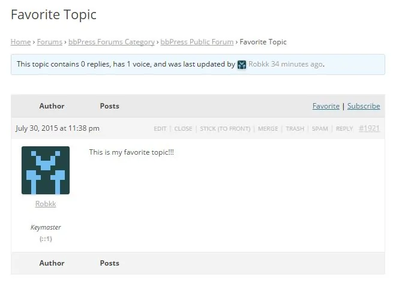
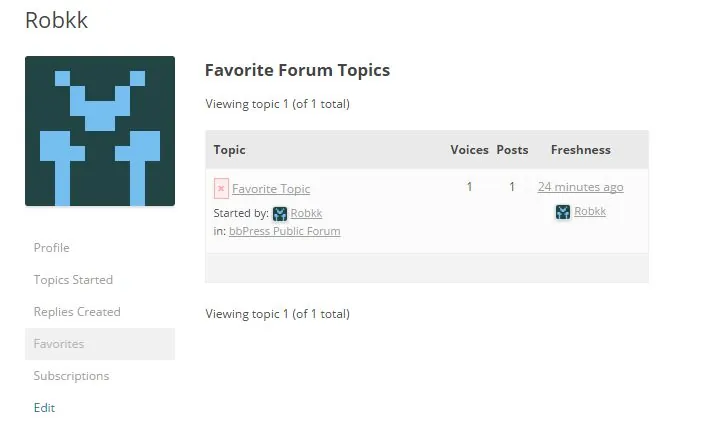

将话题标记为最喜欢的，允许用户在以后添加书签并查看他们最喜欢的话题。
要启用收藏话题的功能：

1. 转到WordPress 后端中的设置 > 论坛
2. 然后在论坛功能部分确保启用“允许用户将话题标记为收藏”

### [将话题标记为收藏](#marking-a-topic-as-favorite)

要使用户收藏某个话题，他们需要单击通常位于话题顶部的“收藏”链接。
 

 
当用户单击收藏夹链接时，它现在将使用 ajax 自动显示为 收藏夹。收藏后，该话题现在也将显示在用户论坛个人资料收藏夹部分。

### [从收藏夹中删除话题](#removing-a-topic-from-favorites)

在收藏夹部分，用户可以查看或管理他们标记为收藏的所有话题。如果用户要从他们个人资料的收藏夹部分中删除任何话题，他们需要单击每个话题附近的红色 X，或者他们也可以从此列表中转到该话题，然后再次单击“已收藏”链接，然后该话题将从他们的收藏夹中删除。
 

