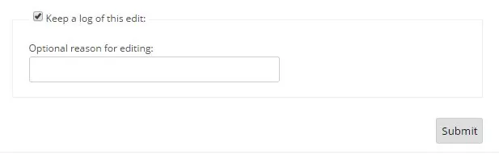
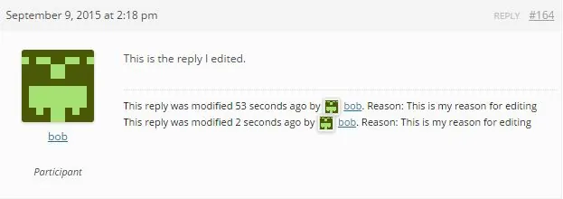

修订日志使用 WordPress 内部现有的修订系统来存储任何帖子编辑的记录，并在任何 bbPress 主题或已编辑的回复的前端显示此信息。
要启用在编辑后显示话题或回复的修订日志的功能：

1. 转到WordPress 后端中的设置 > 论坛
2. 然后在论坛功能部分确保启用“允许话题和回复修订日志记录”

每当您通过单击帖子上的编辑管理链接来编辑话题或回复时，您将看到类似于下图显示的内容。
 

默认情况下会启用一个复选框，表示“保留此编辑的日志”，如果您不希望在帖子的前端显示修订日志，用户可以取消选中该复选框。
还有一个输入框，用户还可以选择在其中输入编辑原因。这有助于论坛中的其他用户了解您编辑特定帖子的原因，无论是拼写错误还是版主留下用户帖子被编辑的原因。
在编辑话题或回复并允许修订日志显示在前端后，保留此编辑的日志复选框保持不变，修订日志看起来与此类似。

修订日志会显示帖子是话题还是回复、帖子被编辑的时间、上次编辑帖子的用户，以及如果用户包含编辑帖子的原因，它也会显示。
如果最后一个编辑回复或话题的用户是能够编辑其他用户帖子的用户，默认情况下是 Keymaster 或版主，那么它将在修订日志中显示该用户的头像和个人资料链接。
