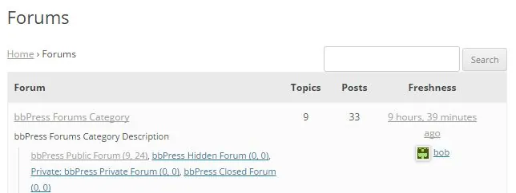
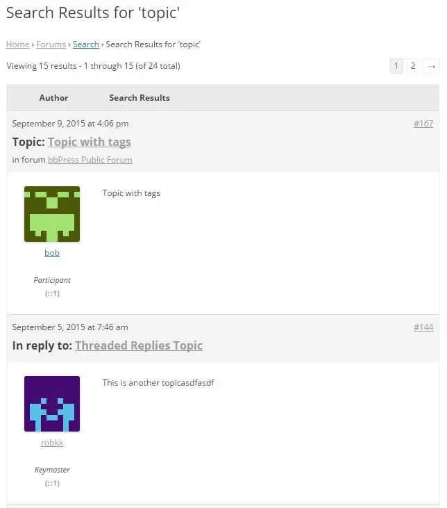

论坛范围内的搜索与 WordPress 的搜索功能非常相似，并且具有很强的可扩展性。如果启用了论坛范围搜索，用户可以通过搜索他们选择的特定关键字来搜索任何回复、话题甚至论坛。
要启用搜索 bbPress 论坛的功能：

1. 转到WordPress 后端中的设置 > 论坛
2. 然后在论坛功能部分确保启用“允许论坛范围搜索”

对于用户搜索论坛，他们需要做的就是在您选择在论坛根目录上显示的布局上方的论坛搜索输入框中添加特定关键字，即论坛索引或话题的新鲜度，或者用户还可以使用 bbPress 搜索小工具搜索论坛。

搜索特定关键字或多个关键字后，默认情况下搜索结果将与此类似。

