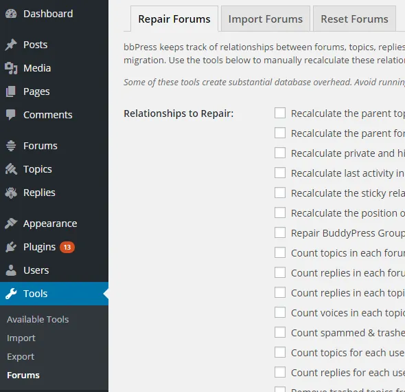

在WordPress 后端的 工具 > 论坛部分，它应该显示三种不同工具中的每一种的选项卡，用于修复、删除论坛或从其他论坛软件导入论坛数据。

### [修复论坛](/tools/repair-forums/ "您需要了解的有关 bbPress 入门的所有信息")

修复论坛选项卡包含的工具可以修复 bbPress 中不同对象的关系并解决您在论坛中可能遇到的一些问题。

### [导入论坛](/document/import-forums/ "您需要了解的有关 bbPress 入门的所有信息")

您可以在此选项卡中开始将以前使用的论坛导入 bbPress。

### [重置论坛](/document/reset-forums/ "您需要了解的有关 bbPress 入门的所有信息")

您可以在此处删除站点上的所有 bbPress 数据。
