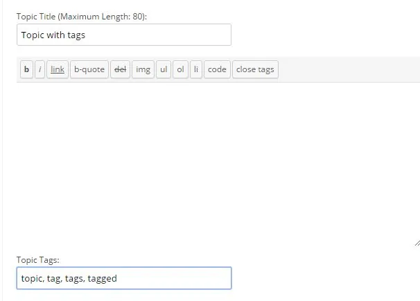
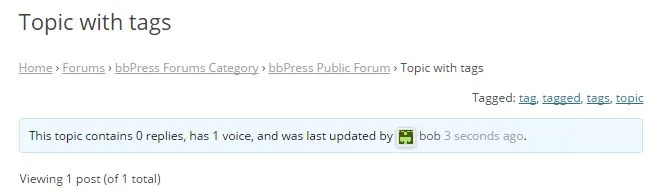
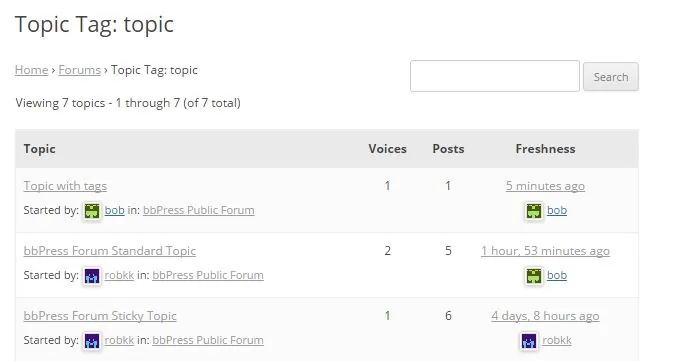
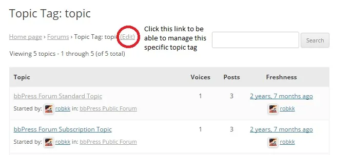
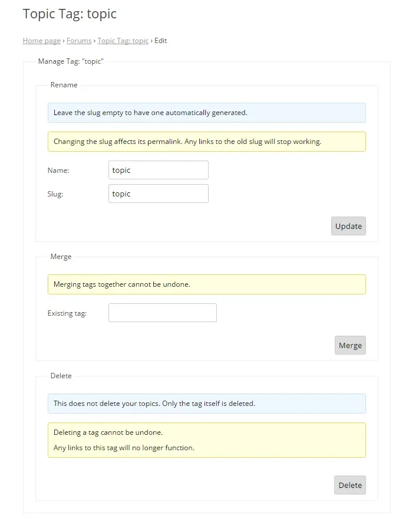
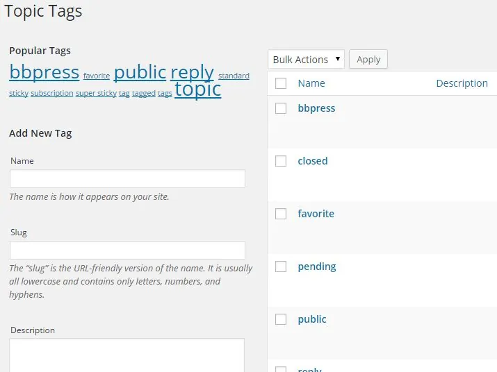

话题标签允许用户在论坛之间进行过滤并显示具有特定话题标签的话题。
如果启用了话题标签，当用户创建话题时，他们可以添加特定标签来快速解释帖子的内容，它还可以帮助用户根据这些标签找到相关话题。
要启用向话题添加标签的功能：

1. 转到WordPress 后端中的设置 > 论坛
2. 然后在论坛功能部分确保启用“允许话题具有标签”

### [向话题添加标签](#adding-tags-to-a-topic)

在创建话题时，用户可以在底部的“话题标签”输入框中输入多个逗号分隔的关键字。

发布话题后，现在将在话题上方显示按字母顺序排序的逗号分隔标签列表。

单击这些标签链接中的任何一个后，您将看到具有相同话题标签的任何话题。

具有后台管理权限的用户也可以从那里的话题创建屏幕创建话题和添加话题标签。您可以在创建内容指南的[创建话题](/document/configuring-bbpress/creating-content/#creating%c2%a0a-topic)部分了解这一点。

### [管理话题标签](#managing-topic-tags)

具有审核功能的用户可以管理话题标签。

输入话题标签编辑链接后，您应该会被定向到此页面。您可以在此处重命名标签、合并到任何其他现有话题标签，或从话题中完全删除标签。

- 重命名- 要重命名话题标签，只需根据自己的喜好更改重命名输入框中的 slug 和名称，然后单击更新。
- 合并- 如前所述，此操作无法撤消，但要将话题标签合并到另一个话题标签，只需在现有标签输入框中输入另一个现有话题标签，然后单击合并。
- 删除- 删除话题标签只会从话题中删除话题标签，正如所指出的，这无法撤消。为此，只需单击“删除”按钮。

可以审核的用户还可以通过编辑主要话题帖子并从话题标签输入框中删除所有要删除的标签来从话题中删除话题标签。
 
您还可以在 WordPress 后端的Topics > Topic Tags 中创建和编辑任何话题标签。

